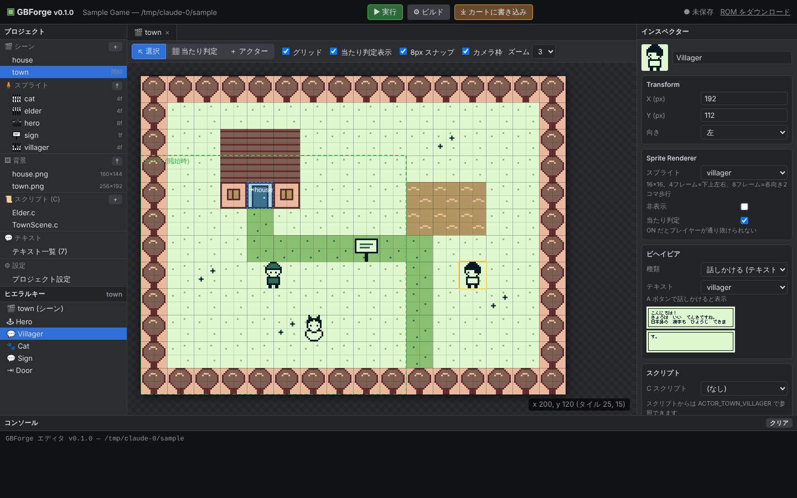
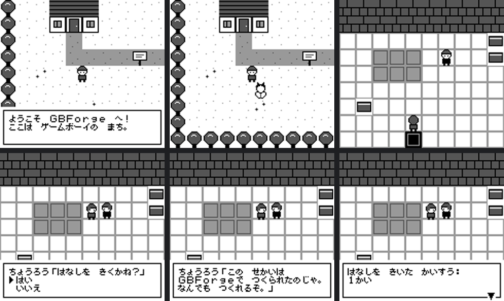
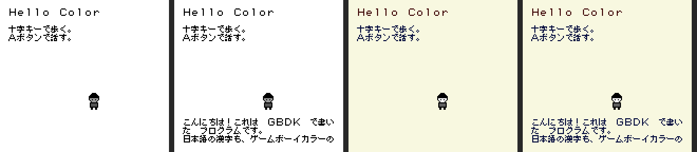

# GBForge — ゲームボーイ版の Unity みたいなもの

## ダウンロード (Windows 10 / 11, 64bit)

| ファイル | 内容 |
|---|---|
| [**GBForge-0.1.0-Setup.exe**](https://github.com/maskdriderkiva-sudo/-/raw/main/download/GBForge-0.1.0-Setup.exe) (25 MB) | 完全版インストーラー (おすすめ)。エミュレータ入り |
| [GBForge-0.1.0-lite-Setup.exe](https://github.com/maskdriderkiva-sudo/-/raw/main/download/GBForge-0.1.0-lite-Setup.exe) (13 MB) | 軽量版インストーラー。エミュレータなし |

使い方:

1. リンクをクリックして保存します
2. 保存したファイルを実行します
3. 「Windows によって PC が保護されました」と出たら、**詳細情報 → 実行** を押します

チェックサムは [SHA256SUMS.txt](download/SHA256SUMS.txt) にあります。

GBForge はゲームボーイ (DMG) 用のゲームエンジンとエディタです。

- **コンパイラは GBDK-2020** を使います。エンジンは C で書かれていて、ユーザーのスクリプトも C で書きます
- **プロジェクト形式**でゲームを管理します。シーン、スプライト、背景、スクリプト、テキストはそれぞれファイルとして保存されます
- **Unity 風のエディタ**があります。シーンビュー、ヒエラルキー、インスペクター、コンソールを備え、ブラウザで動きます
- **日本語フォント**として美咲フォント (8×8) を内蔵しています。かな・カナ・漢字 約 7000 字をゲームボーイ上で表示できます
- **CUBIC STYLE のロムライタ** (GB Cart Flasher 互換) と連動します。ボタン一つでビルドからカートリッジへの書き込み・ベリファイまで行います





---

## インストール

### Windows (おすすめ)

**`GBForge-<版>-Setup.exe`** を実行するだけでインストールできます。

- 管理者権限は不要です (ユーザーごとに `%LOCALAPPDATA%\Programs\GBForge` へインストールされます)
- GBDK-2020 (Windows 版)、Python、エミュレータ、ロムライタドライバがすべて入っています
- スタートメニューに「GBForge」「GBForge コマンドプロンプト」が作られます。デスクトップのショートカットと `project.gbproj` の関連付けも選べます
- アンインストールは「設定 → アプリ」から行えます

インストールしたくない場合は、ポータブル版 `GBForge-<版>-windows-x64.zip` を展開して `GBForge.exe` を実行します。

Windows 版の作り方:

- **Linux から作る:** `nsis` と `gcc-mingw-w64-x86-64` を入れたうえで、次を実行します。CI でも自動で作られます

  ```bash
  python packaging/windows/build_windows.py
  ```

- **Windows で作る:** NSIS と MinGW-w64 を入れれば、同じスクリプトで作れます

### A. オールインワン版 (macOS / Linux)

GBDK-2020、ロムライタドライバ、エミュレータ、Python をすべて同梱したパッケージです。別途インストールするものはありません。

1. `GBForge-<版>-<OS>.zip` を展開します
2. `GBForge` (Windows では `GBForge.exe`) をダブルクリックします
3. ブラウザでスタート画面が開くので、「新しいプロジェクト」を作ります

配布 zip の作り方は 2 通りあります。

- **自分の PC で作る:** その OS 上で次を実行します

  ```bash
  python packaging/build_app.py
  ```

- **GitHub で作る:** GitHub に push してタグ `v*` を付けると、Actions ([.github/workflows/release.yml](.github/workflows/release.yml)) が Windows / macOS (Intel・Apple Silicon) / Linux 版を自動で作り、リリースに添付します

macOS では、初回起動の前に隔離属性を外してください。

```bash
xattr -dr com.apple.quarantine GBForge
```

### B. Python パッケージとして使う

```bash
pip install -e ".[emulator]"
```

```bash
gbforge setup
```

`gbforge setup` は GBDK-2020 4.3.0 を公式リリースからダウンロードし、SHA-256 で検証してから `~/.gbforge` に入れます。

`gbforge setup` を省略しても、最初のビルド時に「ダウンロードしますか？」と聞かれます。エディタでは、ツールバーの「✘ GBDK 未セットアップ」をクリックしてもセットアップできます。

すでに GBDK を持っている場合は、環境変数 `GBDK_HOME` かプロジェクト設定の「GBDK のフォルダ」を指定すれば、そちらが優先されます。

### 状態の確認

```bash
gbforge doctor
```

```text
✔ GBDK-2020   : ~/.gbforge/gbdk/4.3.0/gbdk (GBForge が管理)
✔ ロムライタ   : COM3
✔ エミュレータ : PyBoy (内蔵)
```

エディタのツールバーにも、GBDK とロムライタの状態が常に表示されます。ロムライタは USB に挿すと自動で検出します。

GBDK は次の順番で探します。

1. プロジェクト設定
2. 環境変数 `GBDK_HOME`
3. オールインワン版に同梱されたもの
4. `gbforge setup` で入れたもの
5. PATH 上の `lcc`

## はじめかた

```bash
gbforge new MyGame --name "My Game"
```

```bash
gbforge editor MyGame
```

引数なしで `gbforge` (または `gbforge editor`) を実行すると、スタート画面が開きます。スタート画面では、最近のプロジェクトを開く、新規作成する、といった操作ができます。

`gbforge new` はサンプル付きのプロジェクトを作ります (町 → 家に入る → 長老と会話・2 択・セーブ)。`gbforge editor` はブラウザでエディタを開きます。

エディタの操作:

| 操作 | 内容 |
|---|---|
| ▶ 実行 (F5) | ビルドしてエミュレータで起動 |
| ⚙ ビルド (Ctrl+B) | `build/<タイトル>.gb` を生成 |
| ⤓ カートに書き込み | ビルド → 消去 → 書き込み → ベリファイ |
| V / C / A | 選択ツール / 当たり判定ペイント / アクター追加 |
| 右クリック or Shift + ドラッグ | 当たり判定を消す |
| Delete | 選択中のアクターを削除 |
| Ctrl+S | 保存 |

## 今までの GBDK フォルダをそのまま開く

`C:\gbdk-win64\gbdk\Project\HighwayStar_GBC_v1.9_HW` のような、`main.c` と `build.bat` がある既存のフォルダも、そのまま GBForge で開けます。開き方は次のどれでもかまいません。

- スタート画面の「フォルダを開く」にパスを入れる
- `GBForge.exe` にフォルダをドラッグ&ドロップする
- 次のコマンドを実行する

  ```bash
  gbforge adopt <フォルダ>
  ```

開いたときの動作:

- **フォルダの中身:** 追加されるのは `project.gbproj` だけです。ソースもフォルダ構成も変わりません
- **GBDK の検出:** 親フォルダをさかのぼって自動で見つけます (例: `C:\gbdk-win64\gbdk`)
- **ビルド:** 今までの `build.bat` (Mac / Linux では `build.sh`) をそのまま実行します。最後の `pause` で止まることもありません。できる ROM と、カラー専用かどうかはスクリプトから自動で読み取ります
- **書き込み:** ロムライタへの書き込みでは、ROM ヘッダーのカートリッジ種別 (MBC1/3/5 など) に自動で合わせます

開いたフォルダでは、次のウィンドウが使えます。

| ウィンドウ | できること |
|---|---|
| 🗺 ステージ (シーン) | タイル・矩形塗り・スポイト・GBC パレット・オブジェクト配置を、Undo 付きで直感的に編集できます。`road_map` のような既存のマップ配列を、そのまま開いて編集し、書き戻すこともできます。オブジェクトの種類 (敵・アイテムなど) と値 (速度など) は自分で定義でき、`stage_data.c/.h` に出力されます |
| 🎨 アセット | プロジェクト内の PNG を一覧表示します |
| 🧩 C データ | `assets.c` などの配列 (タイル・パレット・マップ) を、GBC の色で絵として表示します。PNG で書き出し、編集したものを書き戻せます。書き戻すのは `{ … }` の中だけです。パレットは色を選んで編集できます |
| 🧰 変換ツール | PNG をタイル / 8x8・8x16 スプライト / 背景マップに変換します。GBC パレットを自動で作り、`.c` / `.h` として保存します |
| 🕘 バージョン | 「新しいバージョンとして保存」で、`_v1.9` から `_v2.0` へのコピーと `_source.zip` を自動で作ります。兄弟フォルダの版を一覧し、切り替えられます |

`stage_data.c` や変換した `.c` を新しく作ったときは、「ビルドスクリプトに追加」ボタンで `build.bat` の lcc 行に追加できます。元のファイルは `.bak` として残ります。改行コードや Shift_JIS のコメントは変わりません。

C 側では、ステージのデータを次のように使います。

```c
#include "stage_data.h"
const stage_t *st = stages[STAGE_COURSE1];
for (uint8_t i = 0; i < st->object_count; i++) {
    const stage_object_t *o = &st->objects[i];
    if (o->type == OBJ_ENEMY) spawn_enemy(o->x, o->y, o->p[OBJ_ENEMY_SPEED]);
}
```

## C プロジェクト (GB / GBC) と日本語フォントライブラリ gbjp

エンジンを使わず、GBDK で自由にプログラムを書くためのプロジェクトです。

```bash
gbforge new MyApp --type c --target both
```

`--target` は次から選びます。

| 値 | 対象 |
|---|---|
| `dmg` | 初代ゲームボーイ |
| `both` | 初代 + カラー対応 |
| `cgb` | カラー専用 |

```
MyApp/
  src/main.c            プログラム (サンプル: 歩くスプライト + 日本語 + メッセージウィンドウ)
  res/sprites/*.png     → ビルド時に player.h / player.c へ自動変換 (16×16 メタスプライト)
  res/backgrounds/*.png → 背景マップ (_tiles / _map)
  lib/gbjp/             日本語フォントライブラリ (gbjp.h, gbjp.c, font/ は自動生成)
  MyApp.sln / .vcxproj  Visual Studio 用 (自動生成)
  .vscode/              VS Code 用 (自動生成)
```

### gbjp の使い方

```c
#include <gb/gb.h>
#include "gbjp.h"

void main(void) {
    jp_init(128, 128);                      // VRAM タイル 128〜255 を文字に使う
    fill_bkg_rect(0, 0, 32, 32, 128);       // 128 = 空白タイル
    jp_set_palette(1);                      // ゲームボーイカラー: BG パレット 1 で表示
    jp_print(1, 1, "ゲームボーイで日本語！");
    jp_set_palette(0);
    jp_print_box(1, 3, 18, 6, "長い文章は自動で折り返し、行頭禁則も処理します。");
    jp_print_int(1, 10, -1234);
    SHOW_BKG;
}
```

| 関数 | 内容 |
|---|---|
| `jp_init(first, count)` | 文字用の VRAM タイルを確保 (先頭は空白) |
| `jp_print(x, y, s)` | 1 行表示 (UTF-8 の文字列そのまま。半角英数は全角に) |
| `jp_print_box(x, y, w, h, s)` | 折り返し + 行頭禁則。入りきらないと残りのポインタを返す (ページ送り用) |
| `jp_print_int` / `jp_put_char` | 数値 / 1 文字 |
| `jp_set_layer(JP_BKG / JP_WIN)` | 背景かウィンドウに描く |
| `jp_set_color(fg, bg)` | 色番号 |
| `jp_set_palette(p)` | GBC のパレット |
| `jp_set_speed(f)` | タイプライター表示 |
| `jp_reset` / `jp_clear_box` | 画面の書き換え |

- **フォントデータの生成:** ビルドのたびに、ソースの文字列リテラルで使っている文字だけを美咲フォントから抜き出し、`lib/gbjp/font/` に C ファイルとして生成します。全文字 (約 7000 字・約 70KB) を入れるには設定の「フォントに入れる文字」を「全文字」にします
- **バンク配置:** フォントは GBDK の自動バンク配置 (`#pragma bank 255` + `lcc -autobank`) で ROM に配置します
- **VRAM の使い方:** 1 文字 = 1 タイルです。同じ文字はタイルを共有するので、使うのは画面上の異なる文字の数だけです
- **GBForge 以外の GBDK プロジェクトでも使えます:** 次のコマンドで `lib/gbjp` にライブラリとフォントを生成し、自分の Makefile に `lib/gbjp/*.c lib/gbjp/font/*.c` と `-autobank` を追加します

  ```bash
  gbforge jpfont --out lib/gbjp --scan src
  ```

## Visual Studio / VS Code で書く (Unity 風)

開き方は次のどれでもかまいません。

- エディタの「`</>` IDE で開く」を押す
- ソースファイルをダブルクリックする
- 次のコマンドを実行する

  ```bash
  gbforge ide MyApp
  ```

自動で選ばれるのは、Windows に Visual Studio があれば Visual Studio、なければ VS Code です。

- **Visual Studio:** `.sln` と Makefile 形式の `.vcxproj` を生成します。「ビルド」(Ctrl+Shift+B) で GBForge のビルドが走り、F5 でエミュレータが起動します
- **VS Code:** `.vscode/c_cpp_properties.json` と `tasks.json` を生成します。Ctrl+Shift+B でビルドでき、エラー行にジャンプできます。「実行」「カートに書き込み」タスクもあります
- **IntelliSense:** GBDK-2020 の `include`、`gbjp`、生成ヘッダー (`player.h` など) にパスが通っています。SDCC 独自のキーワード (`__banked` / `__at` / `__sfr` など) も補完の邪魔にならないよう定義済みです。エンジンのスクリプト (`scripts/*.c`) でも同じように使えます
- **再生成:** Unity と同じく、IDE 用ファイルはビルドのたびに再生成されます。PC ごとの絶対パスを含むので `.gitignore` 済みです

## プロジェクト構成

```
MyGame/
  project.gbproj          設定 (JSON): 名前, ROM タイトル, 開始シーン, フォント, 変数, ロムライタ設定
  texts.json              日本語テキスト表 { "id": { "text": "...", "choice": false } }
  scenes/<name>.json      シーン: 背景, 当たり判定 (行ごとの "0101..."), アクター, スクリプト
  assets/backgrounds/     背景 PNG (160×144 〜 256×256, ユニークタイル 128 個まで)
  assets/sprites/         スプライト PNG (高さ 16, 16×16 フレームを横に並べる)
  scripts/<Name>.c        C スクリプト
  build/                  生成物 (ROM, 生成 C ソース)
```

すべてテキストか PNG なので、Git で管理できます。

### スプライトの約束事

- 16×16 のフレームを横に並べた PNG です。透明部分はそのまま透過します
- 4 フレームの場合は 下・上・左・右 の向き、8 フレームの場合は各向き 2 コマの歩行アニメになります
- それ以外のフレーム数ではループアニメになります
- 色は白 / 濃い灰 / 黒の 3 色に変換されます (パレット OBP0 = `E0`)

### アクターのビヘイビア (コンポーネント)

| ビヘイビア | 動作 |
|---|---|
| `player` | 十字キーで移動し、A ボタンで目の前を調べる。カメラが追従する |
| `talk` | 調べるとテキストを表示する |
| `warp` | 触れると指定シーンの指定タイル座標へ移動する (ドア・出口) |
| `wander` | ランダムに歩き回る |
| `none` | スクリプトだけで動かす |

1 シーンに置けるアクターは最大 10 体です (16×16 = OBJ 4 枚、計 40 枚)。

## スクリプト (C)

Unity の MonoBehaviour と同じ感覚で書けます。スクリプト名が `Elder` なら、次の関数を定義したものだけが自動で呼ばれます。

```c
#include "gbforge.h"

void Elder_start(Actor *self)    { }   // シーン開始時
void Elder_update(Actor *self)   { }   // 毎フレーム
void Elder_interact(Actor *self) {     // プレイヤーが A ボタンで調べた
    if (msg_choice(TEXT_ELDER_ASK) == 0) {   // 2 択: 0 = 上 / 1 = 下
        vars[VAR_TALKS]++;
        msg_number(vars[VAR_TALKS]);          // テキスト中の {n} に入る
        msg_show(TEXT_ELDER_YES);
        save_game();                          // SRAM (バッテリーバックアップ) に保存
    }
}
```

`TEXT_xxx`、`SCENE_xxx`、`SPRITE_xxx`、`VAR_xxx`、`ACTOR_<シーン>_<名前>` は、ビルド時にプロジェクトから自動生成される定数です。主な API は次のとおりです (全体はエディタの「API リファレンス」か [engine/gbforge.h](gbforge/engine/gbforge.h) を参照)。

| 分類 | 関数 |
|---|---|
| シーン | `scene_load(id)`, `tile_solid(tx, ty)`, `set_tile_solid(tx, ty, v)` |
| アクター | `actor_move(a, dx, dy)` (当たり判定付き), `actor_overlap(a, b)`, `actor_get(i)`, `actor_show/hide`, `actor_face` |
| テキスト | `msg_show(id)`, `msg_choice(id)`, `msg_number(v)`, `text_print(x, y, id)` |
| その他 | `keys` / `keys_pressed` (`J_A` など), `vars[]`, `save_game()`, `load_game()`, `fade_out/in()`, `random8()`, `wait_frames(n)`, `sfx_beep(p)` |

## 日本語テキスト

ゲームボーイ上の表示は 1 文字 8×8 で、メッセージウィンドウは 18 文字 × 3 行です。

| 書き方 | 意味 |
|---|---|
| 改行 | 改行 |
| `---` だけの行 | 改ページ (ボタン待ち) |
| `{n}` | `msg_number()` で渡した数値 |

- 18 文字を超えた行は自動で折り返し、3 行を超えると自動で改ページします。行頭禁則 (「。」「」」「ー」など) にも対応しています
- 半角英数字は全角に変換して表示します。半角カナは全角カナに変換します
- 2 択テキストでは、最後の 2 行が選択肢になります

**仕組み:** ビルダーはプロジェクト内で使われている文字だけを美咲フォントから抜き出し、1 文字 8 バイトで ROM バンクに格納します。表示するときは 1 文字ずつ VRAM の 54 個のスロットへ転送するので、漢字を何千字使っても VRAM の消費は一定です。使用文字数はビルドログに表示されます。フォントは美咲ゴシックと美咲明朝から選べます。

ターミナルで表示を確認することもできます。

```bash
gbforge text "こんにちは、日本語の世界！"
```

## ロムライタ (CUBIC STYLE / GB Cart Flasher)

CUBIC STYLE のロムライタ (ATmega8515 + FT232RL の GB Cart Flasher 互換機、ファームウェアは [cubicstyle/GBCartFlasher-1](https://github.com/cubicstyle/GBCartFlasher-1)) と直接通信します。PC 側のソフトを別途起動する必要はありません。

- **通信方式:** USB シリアル (FTDI)、8N1、72 バイトのパケットと CRC16 (CCITT) によるパケット通信です。CRC エラー時は自動で再送します
- **ボーレート:** 基板のジャンパ設定に合わせて 125000 / **187500 (既定)** / 375000 から選びます
- **設定項目:** MBC (既定 MBC5)、フラッシュアルゴリズム (ALG16 / ALG12 / ALG16WR / ALG12_M29F)、完了検出方式 (TOGGLE / DATA_POLL / DEFAULT / LONGER)。使うフラッシュカートに合わせて、エディタの「設定」で変更します
- **書き込みの流れ:** ステータス読み出し (FW 版数・フラッシュ ID) → 全消去 → 書き込み → 読み出しベリファイ

コマンドラインからも操作できます。

```bash
gbforge ports
```

```bash
gbforge info --port COM3
```

```bash
gbforge flash MyGame --port COM3
```

```bash
gbforge flash game.gb --port /dev/ttyUSB0
```

```bash
gbforge dump --port COM3 --size 1024 backup.gb
```

```bash
gbforge sram read --port COM3 save.sav
```

| コマンド | 内容 |
|---|---|
| `gbforge ports` | ポート一覧。★ が付いたものは FTDI 製 |
| `gbforge info` | ロムライタとカートリッジの情報を表示 |
| `gbforge flash MyGame` | ビルドして書き込み |
| `gbforge flash game.gb` | 既存の ROM をそのまま書き込み |
| `gbforge dump` | カートリッジの ROM を吸い出す |
| `gbforge sram read` / `write` | セーブデータ (SRAM) のバックアップ・復元 |

## 生成される ROM

- MBC5 + SRAM 8KB + バッテリー (カートリッジ種別 `0x1B`)、64KB〜 (データ量に応じて自動で拡張)
- バンク配置
  - バンク 0: エンジン本体とデータの目次
  - バンク 1: ユーザースクリプト
  - バンク 2 以降: 背景、スプライト、テキスト、フォントを詰め込んで配置
- VRAM の割り当て
  - タイル 0〜127: 背景
  - タイル 128〜167: アクター (フレームを都度転送)
  - タイル 192〜255: メッセージウィンドウ

## CLI 一覧

```text
gbforge                         (引数なし) エディタのスタート画面
gbforge setup [--archive F]      GBDK-2020 を自動セットアップ
gbforge doctor                   GBDK / ロムライタ / エミュレータの状態
gbforge play rom.gb              内蔵エミュレータで遊ぶ
gbforge new <dir> [--name NAME] [--empty] [--type engine|c] [--target dmg|both|cgb]
gbforge ide [dir] [--editor visualstudio|vscode] [--file src/main.c] [--no-open]
gbforge jpfont [--out lib/gbjp] [--scan src ...] [--full] [--chars "追加文字"]
gbforge clean [dir]
gbforge adopt <既存の GBDK フォルダ>
gbforge editor [dir] [--port 8765] [--no-browser]
gbforge build [dir]
gbforge run [dir]
gbforge flash [dir|rom.gb] [--port P] [--baud B] [--algorithm A] [--wait-mode W] [--no-erase] [--no-verify]
gbforge ports | info | dump | sram
gbforge text "テキスト" [--font misaki_mincho] [--choice]
```

## テスト

```bash
pip install -e ".[test]"
```

```bash
pytest
```

- `tests/test_flasher.py` はロムライタのファームウェアの挙動を再現した仮想デバイスに書き込み・ベリファイを行い、CRC エラー時の再送や SRAM の読み書きもテストします。CRC がファームウェアのニブルテーブル実装と一致することも確認します
- `tests/test_serial_pty.py` は pty を使って、実際の pyserial 経由で同じ通信をテストします
- `tests/test_rom_pyboy.py` はサンプルを実際に ROM 化し、PyBoy でプレイします。日本語表示、ワープ、2 択、変数のセーブまで自動で確認します。ビルドには **GBDK-2020** を使い、SDCC (sm83) があればテスト用シム (`tests/shim`) 版も合わせて検証します
- `tests/test_toolchain.py` は GBDK インストーラーをテストします。チェックサム検証、パス・トラバーサルの防止、プラットフォームごとのファイル選択を確認します

## ライセンス・クレジット

- **美咲フォント** © Num Kadoma: 商用・非商用を問わず自由に利用・改変・再配布できるフリーフォントです ([gbforge/fonts/MISAKI_LICENSE.txt](gbforge/fonts/MISAKI_LICENSE.txt))
- **ロムライタの通信プロトコル**は、GB Cart Flasher (Kraku & Chroost, Tauwasser 再実装, CUBIC STYLE 拡張) のファームウェアの仕様に基づいて GBForge 側で独自に実装したものです。ファームウェア自体のコードは含んでいません
- **GBDK-2020** は各ツールのライセンス (GPLv2 + リンク例外、SDCC ほか) に従って再配布しています。ライセンス文は同梱の `gbdk/licenses/` にあります
