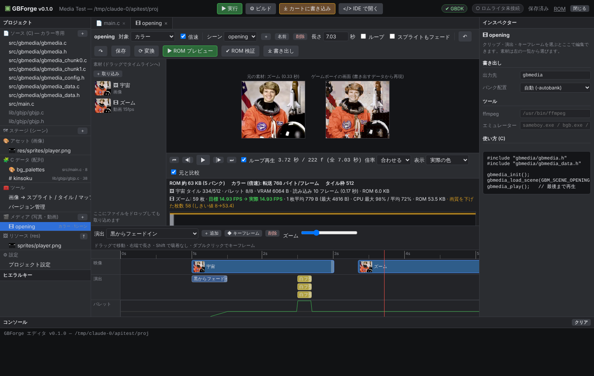

# GB Media Studio — 写真・動画をゲームボーイで表示・再生する



写真・画像・動画を取り込んで、初代ゲームボーイ (4 階調) / ゲームボーイカラー (BG パレット 8 本 × 4 色) 用に変換し、
タイムラインでフェードなどの演出を付けて、GBDK-2020 の C ソースとして書き出す機能です。
GBForge エディタの左の一覧「🎬 メディア (写真・動画)」の **＋** から始めます。

## できること

| 分類 | 内容 |
|---|---|
| 取り込み | 画像: PNG / JPEG / BMP / WebP / GIF。動画: MP4 / WebM / MOV / MKV / AVI、アニメ GIF、連番画像のフォルダ。元のファイルは `media/sources/` にコピーして使い、書き換えません |
| 160×144 への合わせ方 | いっぱい (はみ出しを切る) / 全体 (余白) / 引き伸ばし、拡大と切り出し位置 |
| 調整 | 明るさ・コントラスト・ガンマ・彩度・黒/白レベル・シャープ・ノイズ除去・白黒化 |
| ディザリング | なし / Floyd–Steinberg / Atkinson / Bayer 2×2・4×4・8×8、強さ |
| プリセット | 標準 / 古いモノクロ写真 / 高コントラスト・ホラー / 薄暗い室内 / 粗い写真 / レトロフィルム / イラスト・ドット絵 |
| 動画 | 目標 FPS・開始/終了・速度・差分しきい値・1 枚の新タイル上限・ループ・「FPS を必ず守る」 |
| 演出 | 黒/白からのフェードイン、黒/白へのフェードアウト、白/黒フラッシュ、点滅、古いフィルムの明滅、不規則な輝度変化、ホラー。フレーム単位で長さを調整 |
| パレットのキーフレーム | 明るさ -31 (黒) 〜 0 (元の色) 〜 +31 (白) を、少しずつ / 段階で変える |
| タイムライン | 映像・演出・パレットのトラック、目盛り、再生位置、ドラッグで移動、右端で長さ変更、吸着 (Shift で無効)、素材をドラッグ&ドロップ、ズーム、1 フレーム送り、ループ再生、元に戻す/やり直し (Ctrl+Z / Ctrl+Y) |
| プレビュー | 1x / 2x / 4x / 8x / 合わせる、DMG 緑 / DMG グレー / 実際の色、元の素材との比較 |
| ハードの制約の表示 | ROM 使用量・タイル数・パレット数・VRAM 転送量・読み込みにかかるフレーム数・動画の目標 FPS と実際の FPS・CPU 使用率の目安・1 枚ごとの転送量のグラフ、問題があれば日本語で原因と直し方 |
| 書き出し | `gbmedia/` に C ソース (再生ライブラリ + データ)。GBForge のビルドでそのままコンパイルされます |
| ROM プレビュー | 編集中のシーンだけを再生するデモ ROM を GBDK でコンパイルし、エミュレーター (SameBoy / BGB / mGBA など、設定可) で起動。コンパイルエラーはコンソールに表示 |
| ROM 検証 | デモ ROM を PyBoy で動かし、プレビューと 1 フレームずつ比較 (実機相当の FPS・フレーム落ちを実測) |

## 使い方 (C)

```c
#include <gb/gb.h>
#include "gbmedia/gbmedia.h"
#include "gbmedia/gbmedia_data.h"     // GB Media Studio が書き出す

void main(void) {
    SHOW_BKG;
    DISPLAY_ON;
    gbmedia_init();
    gbmedia_load_scene(GBM_SCENE_OPENING);   // シーン名から自動で作られる
    gbmedia_play();                          // 最後まで再生して戻る
}
```

ゲームループの中で使うときは `gbmedia_play()` の代わりに次のようにします。
`gbmedia_update()` は必ず `vsync()` の直後に呼んでください (パレットと画面の切り替えを VBlank の始めに書き込むため)。

```c
vsync();
gbmedia_load_scene(GBM_SCENE_OPENING);
while (gbmedia_update()) {
    /* ゲームの処理 */
    vsync();
}
```

その他の関数: `gbmedia_stop()`, `gbmedia_set_level(-31〜31)`, `gbmedia_set_obj_palettes(pal, n)` (スプライトのパレットも一緒にフェードさせる時)。
状態: `gbmedia_frame`, `gbmedia_video_frame`, `gbmedia_late_frames` (予定より遅れた動画フレーム数), `gbmedia_max_lag`, `gbmedia_cut_updates`。

リンクには `lcc -autobank` が必要です (GBForge のビルドは対応済み)。`-autobank` を使わない build.bat では、
メディアプロジェクトの設定で「バンク配置: 固定バンク」にして、`gbmedia/*.c` をビルドスクリプトに追加してください
(書き出し後にエディタが追加ボタンを出します)。

## 仕組み

- 画像と動画のフレームは「タイル・マップ・属性・パレット」の差分 (更新レコード) として ROM に入ります。
  動画は前のフレームと同じタイル (カラーでは反転も) を再利用し、変わった所だけを送ります
- **LCD は止めません**。レコードは毎フレーム決まった量ずつ VRAM に送り (STAT を見て、アクセスできる間だけ書く)、
  BG マップ 2 枚 (0x9800 / 0x9C00) を交互に使って、送り終えたら VBlank 中に LCDC で切り替えます
- **フェードはパレットだけ**: 初代は BGP / OBP0 / OBP1 を 4 階調で段階的に、カラーは書き出し時に作った「63 段階のパレット表」を
  VBlank の始めに書き込みます (計算は前のフレームの終わりに済ませておく)
- **プレビューは書き出すデータから作ります**。Python のシミュレーターが再生ライブラリと同じ規則でレコードを再生した画面なので、
  「プレビューでは動くのに実機では違う」ということが起きないようにしています。ROM 検証で実際に一致することを確かめられます

### 1 フレームに送れる量 (PyBoy で計測)

| モード | 1 フレームの転送量 | 区切り 1 つの手間 | 根拠 |
|---|---|---|---|
| 初代 | 448 バイト | 22 バイト分 | 512 では次の VBlank へのはみ出しが起きた |
| カラー (等速) | 384 バイト | 22 バイト分 | 448 では次の VBlank へのはみ出しが起きた |
| カラー (倍速 `cpu_fast`) | 768 バイト | 32 バイト分 | 896 でも問題なかったが、実機との差を考えて余裕を残した |

負荷試験 (写真 4 枚の連続読み込み + フェード、動画 2 本、サンプルの全シーン) の全モードで、
「時間切れの打ち切り 0 回・はみ出し 0 回・全フレームがプレビューと一致」を確認しています (テスト `tests/test_media.py`)。
ただし **実機 (本物のゲームボーイ) ではまだ確認していません**。エミュレーターと実機のタイミングの差がありうるため、上の値には余裕を持たせています。
再生ライブラリには、それでも時間が足りなくなった時に転送を次のフレームに回す安全装置があり、その回数は `gbmedia_cut_updates` で分かります。

### 画質・FPS・ROM のトレードオフ (サンプルのズーム動画、カラー倍速、320×288 → 160×144)

| 目標 FPS | 実際の FPS | 1 枚の平均転送量 | 画質を下げた枚数 | ROM (動画 4 秒) |
|---|---|---|---|---|
| 15 | 14.93 | 779 バイト | 58 / 59 | 53 KB |
| 10 | 9.95 | 1087 バイト | 38 / 39 | 47 KB |
| 7.5 | 7.47 | 1868 バイト | 26 / 29 | 59 KB |
| 6 | 5.97 | 3274 バイト | 7 / 23 | 80 KB |

画面全体が毎フレーム変わる動画 (ズームなど) は、FPS を上げるほど 1 枚に送れる量が減り、差分しきい値を上げて細かな変化を省くことになります。
GB Media Studio はこれを隠さず「画質を下げた枚数」と「しきい値」で表示します。「FPS を必ず守る」をオフにすると、
画質を下げすぎる代わりに表示時間を延ばします (その分 FPS が下がり、実際の FPS として表示されます)。
動画の先頭フレームは再生前に読み込む (タイムラインが読み込み時間の分だけ早く始める) ので、画質を落としません。

## ファイル

| 場所 | 内容 |
|---|---|
| `media/<名前>.gbmedia` | メディアプロジェクト (JSON)。保存のたびに 1 つ前の内容を `.gbmedia.bak` に残します |
| `media/sources/` | 取り込んだ素材のコピー |
| `media/.cache/` | 変換のキャッシュ (消しても作り直されます) |
| `src/gbmedia/` (または出力先) | 書き出した C ソース。編集しないでください (書き出すたびに上書きされます) |
| `build/media_demo/` | ROM プレビュー用のデモ ROM |

既存のプロジェクトのファイル (ソース・build.bat・project.gbproj など) は変更しません。書き出し先の `gbmedia/` だけを作り直します。

## 必要なもの

- **numpy** と **Pillow** (インストーラー版には入っています。pip の場合は `pip install -e .` で入ります)
- 動画の読み込みに **ffmpeg** (別途インストール): Windows では `winget install Gyan.FFmpeg`。
  よく使われる ffmpeg の配布物は GPL のコーデックを含むため、GBForge には同梱していません。
  ffmpeg が無い場合は PyAV (`pip install av`) も使えます。アニメ GIF と連番画像は ffmpeg なしで読めます
- ROM プレビューに **GBDK-2020** (GBForge が自動で入れます) とエミュレーター (設定で指定。無ければ PyBoy)
- ROM 検証に **PyBoy** (完全版インストーラーに入っています)

## まだできないこと・注意

- **KIVA GB STUDIO の `.kgbproj` / KIVA GB IMAGE CONVERTER**: 開発時に参照できたリポジトリにはこれらのソースやファイル形式が無かったため、
  `.kgbproj` の読み込み・連携は実装していません。GB Media Studio は独自の `.gbmedia` を使い、`.kgbproj` を読んだり書き換えたりすることはありません。
  ファイル形式が分かれば、変換設定の取り込みなどを追加できます
- 前の絵が表示されている間に次の画像・動画へ切り替えると、読み込み中に VRAM のタイルが上書きされ、一瞬乱れることがあります
  (タイムラインが警告します)。暗転・ホワイトアウト中に切り替えれば確実です。カラーでタイルを VRAM バンクで交互に使う方式は未実装です
- 「エンジン」型のプロジェクト (シーン・アクターをエディタで作る方) のシーンから呼び出す機能は未実装です。C プロジェクトで使ってください
  (デモ ROM での確認はどちらでもできます)
- 映像は BG だけを使います (スプライトは使いません)。音声はありません
- ループする動画は、つなぎ目で先頭フレームの読み込みに時間がかかる場合があり、その時は警告が出ます
